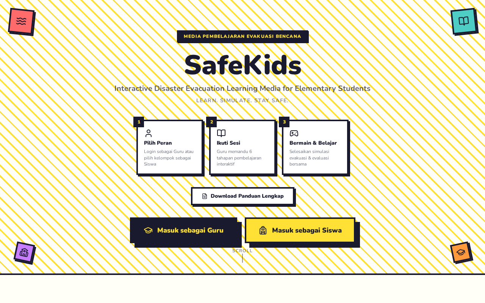
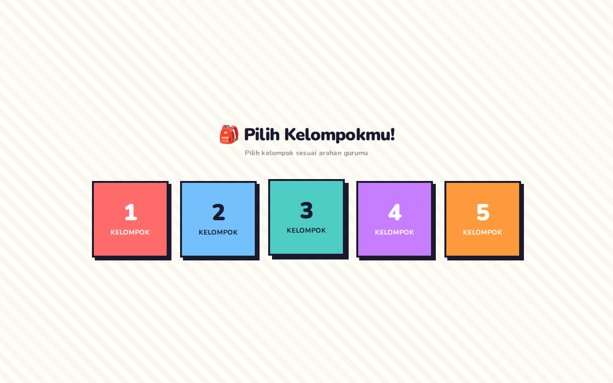
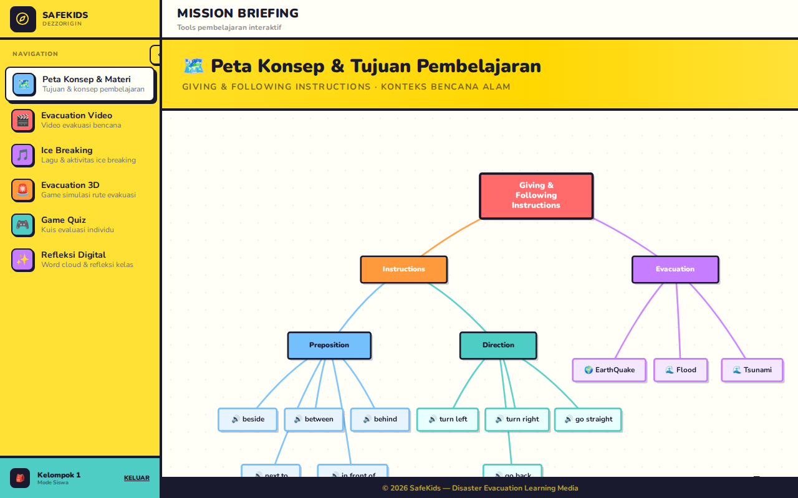
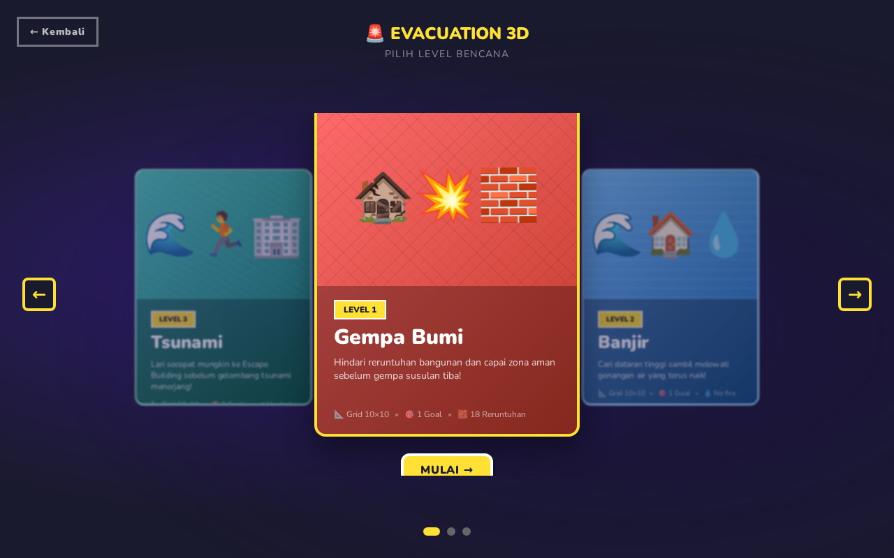
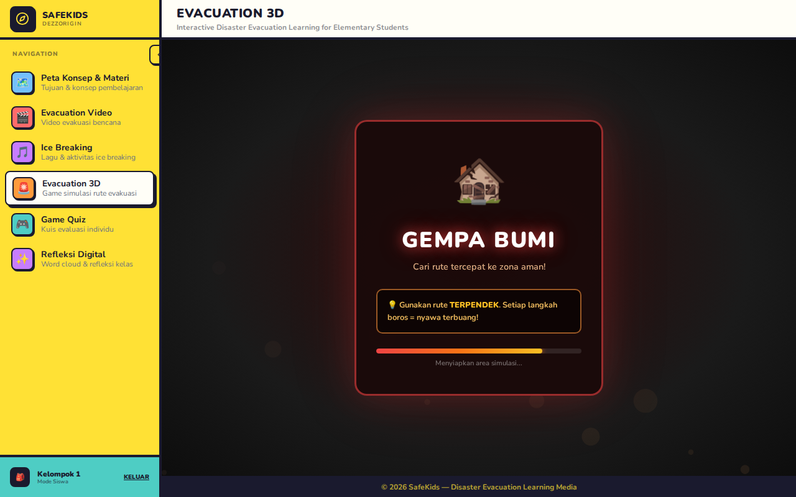

# SafeKids

**Live:** https://safekids-app.pages.dev/ ·
**Repo:** https://github.com/dezzorigin/safekids

SafeKids — *Interactive Disaster Evacuation Learning Media for
Elementary Students*. Media pembelajaran evakuasi bencana interaktif
untuk siswa sekolah dasar: simulasi 3D gempa, banjir, dan tsunami di
peta 10×10, dipandu guru dalam 6 langkah ±90 menit. Dikembangkan oleh
dezzorigin.

## Screenshot

Screenshot asli aplikasi, direkam Playwright dari hasil build di CI
(1280×800, desktop):











## Video demo

[](docs/demo.mp4)

[▶ Tonton demo (MP4, 25 detik)](docs/demo.mp4)

> Video menunjukkan alur siswa yang beneran jalan: beranda → masuk
> sebagai siswa → pilih kelompok → sesi (Peta Konsep) → simulator 3D
> (pilih level + mulai Gempa). Direkam dalam mode demo (tanpa kunci
> Supabase): pilih kelompok tetap jalan lokal — login guru dan
> sinkronisasi data kelas tidak ditunjukkan di video ini. Kartu
> `og-image.png` tetap dipakai untuk link preview — itu gambar preview
> yang digambar, bukan screenshot.

## Beranda

Beranda aplikasi (bukan landing marketing): hero dengan 3 kartu
quick-start (Pilih Peran → Ikuti Sesi → Bermain & Belajar), tombol
Download Panduan Lengkap, 2 CTA (Masuk sebagai Guru / Masuk sebagai
Siswa), lalu Peta Konsep Pembelajaran dan Alur Pembelajaran Hari Ini
(6 langkah, ±90 menit).

## Cara main (satu sesi kelas)

| Langkah | Modul | Rute |
|---|---|---|
| 1 | Peta Konsep — guru menjelaskan materi & tujuan | `/` |
| 2 | Spin Wheel — pembagian kelompok secara acak | `/teammaker` |
| 3 | Evacuation Video — Tsunami Aceh vs Jepang | `/video` |
| 4 | Tutorial & Ice Break — video AR + lagu | `/tutorial` |
| 5 | Evacuation 3D — simulasi rute evakuasi | `/simulator` |
| 6 | Quiz + Refleksi — evaluasi & word cloud kelas | `/evaluation`, `/reflection` |

**Siswa** masuk tanpa password: pilih kelompok, lalu ikuti sesi.
**Guru** masuk lewat `/admin/login`, lalu membuka Dashboard Guru
(`/dashboard-guru`): rekap skor tiap kelompok, ekspor laporan PDF/Word.

## Simulator 3D

Tiga level bencana di grid 10×10 — susun perintah maju/belok, hindari
rintangan, capai titik aman:

- **Gempa** — reruntuhan menutup jalan; cari rute terpendek.
- **Banjir** — rumah terendam dan pagar pohon membatasi gerak.
- **Tsunami** — dua titik aman, ombak datang dalam **75 detik**.

## Menjalankan lokal

```bash
npm ci            # di CI; di VM dev pakai: npm ci --no-bin-links --ignore-scripts
npm run dev       # http://localhost:5173
npm run build     # tsc && vite build → dist/
npm run lint      # eslint . (0 error; 30 warning utang teknis, lihat docs/TESTING.md)
npm run e2e       # Playwright: desktop + Pixel 7 (butuh browser Playwright)
```

### Mode demo (tanpa Supabase)

Aplikasi jalan penuh **tanpa kredensial**: simulator, kuis, refleksi,
dan team maker semuanya lokal. Login guru + sinkronisasi data kelas
hanya aktif bila kredensial proyek Supabase sendiri diisi — salin
`.env.example` ke `.env.local` lalu isi. Jangan commit file `.env`
berisi kredensial nyata.

## Tech stack

Vite 5 · React 18 + TypeScript · React Three Fiber 8 + three.js ·
Zustand · Tailwind 3 · Supabase (opsional) · Playwright

Arsitektur lengkap: [`docs/ARCHITECTURE.md`](docs/ARCHITECTURE.md) +
[`docs/diagram.html`](docs/diagram.html) · Desain:
[`docs/DESIGN.md`](docs/DESIGN.md) · PRD: [`docs/PRD.md`](docs/PRD.md) ·
Testing: [`docs/TESTING.md`](docs/TESTING.md) · Deploy:
[`docs/DEPLOY.md`](docs/DEPLOY.md)

## Struktur

```
index.html                  # shell SPA + meta OG/Twitter
public/                     # compass.svg, og-image.png, _redirects (SPA fallback)
src/
  App.tsx                   # routing (14 rute)
  store/useSimulationStore.ts  # LEVELS gempa/banjir/tsunami + status game
  components/3d/            # Avatar, Environment, MapGrid
  components/layout/        # MainLayout, Sidebar, TopNavigation, TeacherRoute
  components/ui/            # ConceptMap, InstructionPanel, dsb.
  pages/                    # WelcomePage (beranda asli), Simulator, Evaluation, ...
scripts/                    # advisory-sweep.py (OSV), make-og-image.py (PIL)
e2e/landing.spec.ts         # Playwright
```

## Lisensi

MIT — lihat [LICENSE](./LICENSE).

---
Dikembangkan oleh **dezzorigin** · SafeKids — Disaster Evacuation Learning Media.
